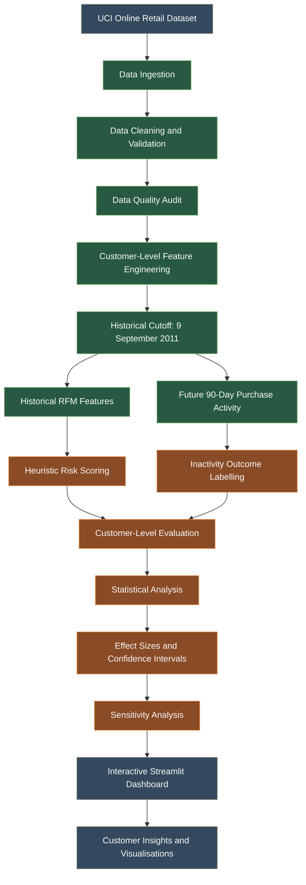
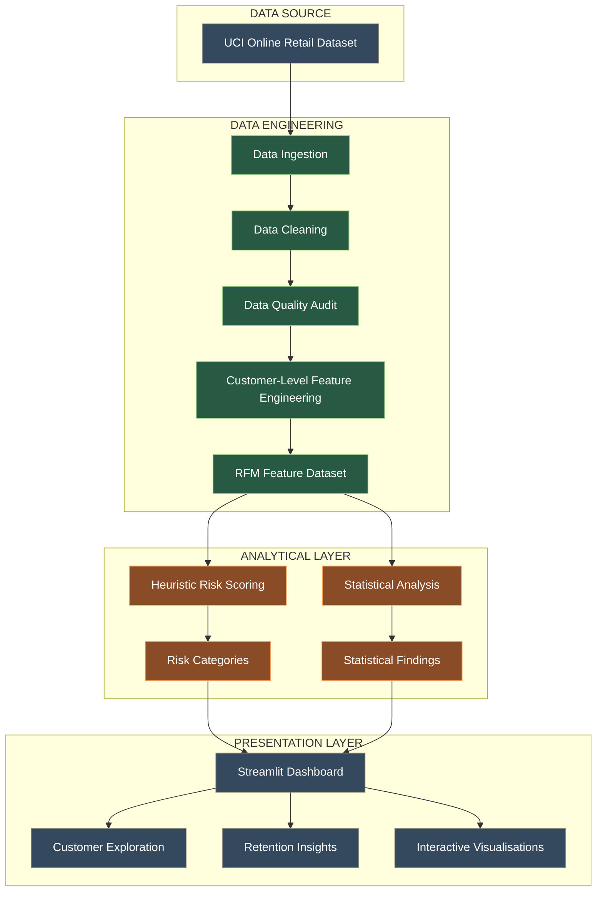
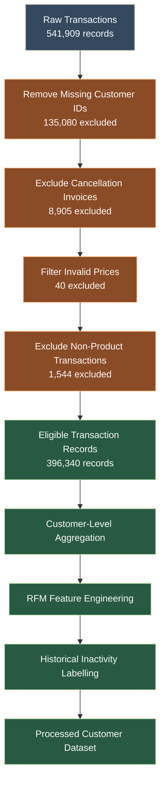
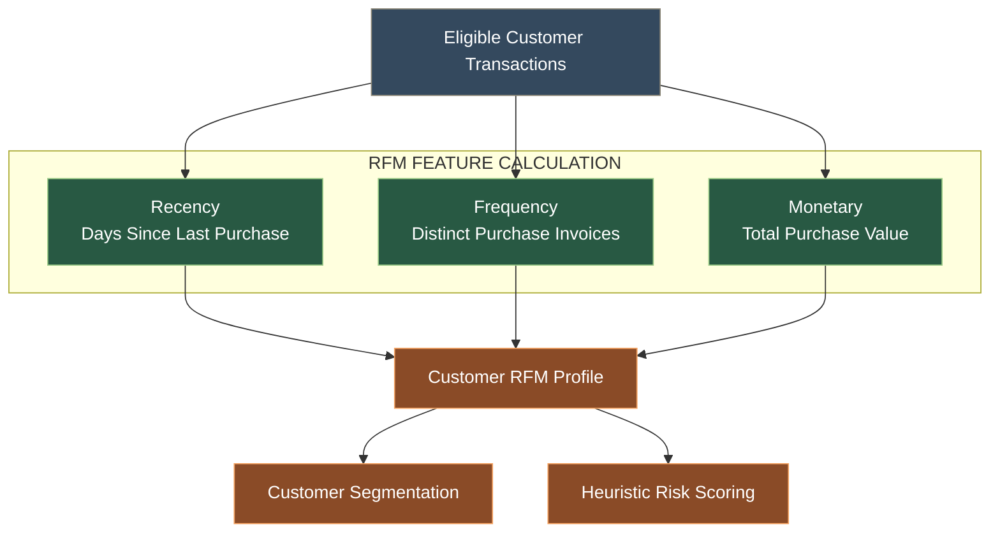
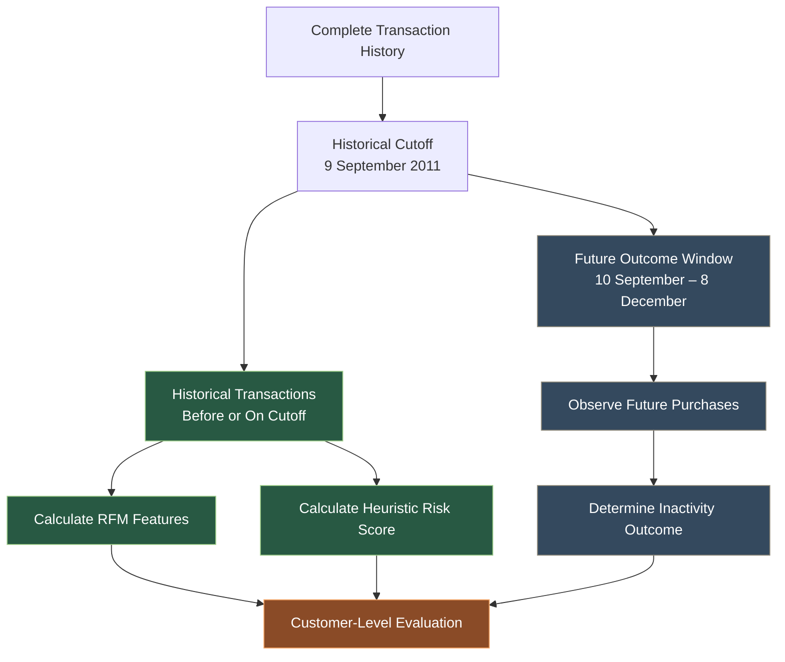
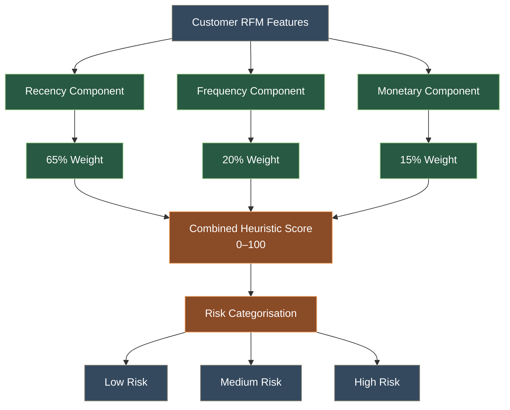
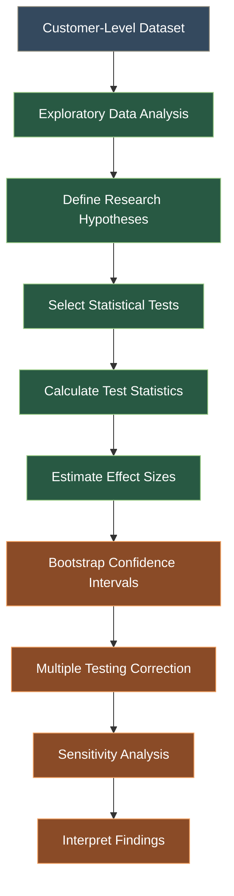

# ChurnGuard AI

### An Open-Source Statistical Framework for Customer Retention Analysis Using Python

**Customer Analytics · RFM Segmentation · Statistical Computing · Data Visualisation**


ChurnGuard AI is a Python-based customer retention analysis framework designed to investigate purchasing behaviour, identify inactivity patterns, and explore relationships between historical purchasing activity and future customer behaviour.

The project combines customer-level RFM analysis, transparent heuristic risk scoring, statistical evaluation, and interactive visualisation.

**Research proposal:** Submitted to SciPy India 2026 as a poster proposal.

**Development status:** The initial data engineering pipeline and 18 automated tests are complete. Standalone scoring equivalence, statistical analysis, sensitivity testing, and final dashboard integration remain under development.

---

# 1. Project Overview

Customer retention is an important challenge for businesses operating in competitive markets.

ChurnGuard explores how historical purchasing behaviour can help identify customers who may become inactive.

Rather than treating a heuristic score as a machine-learning prediction, the framework separates:

* Historical customer behaviour
* Rule-based risk indicators
* Observed future inactivity
* Statistical associations
* Predictive performance evaluation

The primary objective is to create a transparent and reproducible statistical framework using Python and the scientific computing ecosystem.

# 2. System Architecture

ChurnGuard follows a modular architecture that separates data preparation, feature engineering, statistical analysis, and presentation.

## 2.1 End-to-End Project Workflow

The following workflow illustrates how transaction data moves through ChurnGuard, from raw data ingestion to customer analysis and visualisation.



**Key principle:** Historical purchasing information is used to calculate customer features and risk scores, while future purchasing activity is used separately to determine observed inactivity. This separation helps prevent temporal data leakage.

## 2.2 Architecture Overview



## 2.3 Core Components

| Component            | Responsibility                                     |
| -------------------- | -------------------------------------------------- |
| Data Pipeline        | Cleaning and validating transaction data           |
| Feature Engineering  | Creating customer-level RFM features               |
| Heuristic Scoring    | Calculating transparent risk indicators            |
| Statistical Analysis | Testing relationships and estimating effect sizes  |
| Dashboard            | Interactive customer exploration and visualisation |

# 3. Data Processing Pipeline

ChurnGuard uses the UCI Online Retail dataset.

The original dataset contains **541,909 transaction records** covering December 2010 to December 2011.

The preprocessing pipeline applies documented cleaning and exclusion rules.

## 3.1 Processing Workflow



## 3.2 Initial Data Audit

| Metric                                |  Result |
| ------------------------------------- | ------: |
| Raw transaction records               | 541,909 |
| Missing CustomerID records            | 135,080 |
| Records after missing-ID exclusion    | 406,829 |
| Cancellation invoice records excluded |   8,905 |
| Invalid-price records excluded        |      40 |
| Non-product records excluded          |   1,544 |
| Remaining valid transaction records   | 396,340 |
| Valid customers                       |   4,334 |

These figures describe the initial cleaning pipeline. The audit reports preserve the exclusion counts.

### Data Quality Considerations

* Missing customer identifiers prevent customer-level attribution.
* Cancellation invoices are excluded from eligible purchases.
* Invalid prices are excluded.
* Non-product transaction codes are handled separately.
* Duplicate records are audited rather than silently discarded.

Approximately **£1.76 million in positive sales** associated with missing customer identifiers is not represented in customer-level RFM analysis. This is an important limitation.

# 4. RFM Feature Engineering

RFM analysis represents customer purchasing behaviour through three features.

## 4.1 Feature Engineering Workflow



## 4.2 Feature Definitions

| Feature   | Definition                                              |
| --------- | ------------------------------------------------------- |
| Recency   | Days since the customer's most recent eligible purchase |
| Frequency | Number of distinct purchase invoices                    |
| Monetary  | Total eligible purchase value                           |

The analysis uses GBP (£) as the transaction currency.

# 5. Historical Evaluation Framework

An important design decision is the separation of historical customer features from future inactivity outcomes.

This helps prevent temporal data leakage.

## 5.1 Evaluation Configuration

| Parameter         | Configuration                               |
| ----------------- | ------------------------------------------- |
| Historical cutoff | 9 September 2011                            |
| Outcome window    | 10 September – 8 December 2011              |
| Outcome duration  | 90 complete days                            |
| Inactivity proxy  | No valid purchase during the outcome window |

## 5.2 Temporal Evaluation Workflow



A customer is labelled inactive when they have no valid purchase in the subsequent 90-day window.

**Important:** This is an operational inactivity proxy, not proof of permanent customer churn.

## 5.3 Initial Cohort Results

| Metric                           | Result |
| -------------------------------- | -----: |
| Eligible customers               |  3,368 |
| Customers classified as inactive |  1,451 |
| Observed inactivity rate         |  43.1% |

Customers first appearing after the historical cutoff are excluded from the evaluation cohort because they do not have historical purchasing information at the cutoff.

# 6. Heuristic Risk Scoring

The existing dashboard uses a transparent rule-based scoring approach.

The score combines three components.

## 6.1 Scoring Architecture



## 6.2 Scoring Weights

| Component | Weight |
| --------- | -----: |
| Recency   |    65% |
| Frequency |    20% |
| Monetary  |    15% |

The scoring system uses percentile-based scaling for frequency and monetary values and a configurable inactivity threshold for recency.

The dashboard categorises customers into Low, Medium, and High risk groups.

**Methodological distinction:** This is a heuristic risk indicator. It is not a trained machine-learning model and must not be interpreted as a calibrated churn probability.

# 7. Statistical Analysis Framework

The research component investigates whether customer purchasing behaviour differs between customers who remain active and those who become inactive during the outcome window.

## 7.1 Planned Statistical Methods

| Method               | Research Purpose                                                |
| -------------------- | --------------------------------------------------------------- |
| Mann–Whitney U       | Compare RFM distributions between active and inactive customers |
| Spearman Correlation | Examine monotonic relationships between customer features       |
| Chi-square Test      | Examine associations between categorical variables              |
| Kruskal–Wallis       | Compare outcome distributions across customer segments          |
| Bootstrap            | Estimate confidence intervals                                   |
| Sensitivity Analysis | Examine robustness under alternative analytical configurations  |

## 7.2 Statistical Workflow



The planned primary analysis includes six hypotheses, with Holm correction across the six primary tests.

Pairwise post-hoc comparisons will use a separate multiple-testing correction family.

Effect sizes and confidence intervals will accompany statistical significance wherever appropriate.

**Status:** This statistical module is not yet complete. The methods above describe the planned analysis, not completed research findings.

# 8. Interactive Dashboard

The project includes a Streamlit dashboard designed to make customer analytics easier to explore.

## 8.1 Dashboard Modules

| Module             | Purpose                               |
| ------------------ | ------------------------------------- |
| Overview           | High-level customer analytics         |
| Customer Explorer  | Explore individual customer behaviour |
| Retention Playbook | Review retention recommendations      |
| Profile            | Customer profile functionality        |
| About              | Project information                   |

## 8.2 Technology Stack

* Python
* Pandas
* NumPy
* SciPy
* Streamlit
* Plotly
* OpenPyXL

# 9. Repository Structure

```text
ChurnGuard-AI/
│
├── churnguard/
│   ├── __init__.py
│   ├── config.py
│   ├── data_pipeline.py
│   ├── features.py
│   └── build_dataset.py
│
├── tests/
│   ├── __init__.py
│   └── test_pipeline.py
│
├── data/
│   ├── raw/
│   └── processed/
│
├── churnguard_scipy_redesign.py
├── requirements_voice.txt
├── .gitignore
└── README.md
```

Raw data, generated customer-level datasets, virtual environments, and local backups are intentionally excluded from version control.

# 10. Installation and Setup

## Step 1: Clone the Repository

```bash
git clone https://github.com/akshaykumarj952-commits/ChurnGuard-AI.git
cd ChurnGuard-AI
```

## Step 2: Create a Virtual Environment

```bash
python -m venv .venv
```

Activate it on Windows:

```powershell
.venv\Scripts\Activate.ps1
```

## Step 3: Install Dependencies

```bash
pip install -r requirements_voice.txt
pip install scipy openpyxl
```

## Step 4: Download the Dataset

Download the Online Retail dataset from the UCI Machine Learning Repository:

https://archive.ics.uci.edu/dataset/352/online+retail

Place the downloaded Excel file at:

```text
data/raw/Online Retail.xlsx
```

## Step 5: Build the Processed Dataset

```bash
python -m churnguard.build_dataset
```

The pipeline generates:

```text
data/processed/customers_features.csv
data/processed/data_audit.json
data/processed/data_audit.md
```

The generated customer-level CSV is excluded from Git version control.

## Step 6: Run the Dashboard

```bash
python -m streamlit run churnguard_scipy_redesign.py
```

## Step 7: Run Automated Tests

```bash
python -m unittest tests.test_pipeline -v
```

The initial pipeline test suite contains 18 tests covering synthetic and real-data scenarios.

# 11. Reproducibility and Data Protection

ChurnGuard is designed to keep analytical outputs separate from private input data.

Important practices include:

* Documented preprocessing rules
* Fixed historical evaluation cutoff
* Separation of historical features and future outcomes
* Automated pipeline tests
* Duplicate transaction auditing
* Explicit exclusion reporting
* Customer-level data excluded from the public repository

# 12. Limitations

The current research has several limitations:

1. The dataset represents a single online retail business.
2. Customer identifiers are missing for a substantial proportion of transactions.
3. The inactivity definition is based on a fixed 90-day observation window.
4. The evaluation period includes seasonal purchasing effects.
5. The current risk score is heuristic rather than model-trained.
6. RFM segments and risk categories partly depend on recency, so some statistical relationships are structurally expected.
7. Statistical validation and sensitivity analyses are still in development.

# 13. Development Roadmap

The project is being developed incrementally, with an emphasis on reproducibility and statistical validity.

## 13.1 Development Workflow


## 13.2 Implementation Checklist

### Completed

* [x] Initial project structure
* [x] Dataset acquisition
* [x] Data cleaning pipeline
* [x] Customer-level RFM feature engineering
* [x] Historical inactivity outcome construction
* [x] Initial automated tests
* [x] GitHub repository

### In Development

* [ ] Standalone heuristic scoring implementation
* [ ] Heuristic equivalence tests
* [ ] Statistical hypothesis testing
* [ ] Effect-size estimation
* [ ] Bootstrap confidence intervals
* [ ] Sensitivity analysis
* [ ] Dashboard integration
* [ ] Research poster

# 14. Conference Submission

**SciPy India 2026**

Proposed poster title:

*ChurnGuard: An Open-Source Statistical Framework for Customer Retention Analysis Using Python*

The proposal has been submitted. Submission does not imply acceptance or conference endorsement.

# 15. Dataset Citation and Acknowledgements

Chen, D. (2015). *Online Retail* [Dataset]. UCI Machine Learning Repository.

https://doi.org/10.24432/C5BW33

**Dataset licence:** Creative Commons Attribution 4.0 International (CC BY 4.0).

The dataset is provided by the UCI Machine Learning Repository. Its original attribution and licence must be preserved when using or redistributing the data.

# 16. Author

**Akshay Kumar Jha**

Student | Python | Data Analytics | Statistical Computing

GitHub: https://github.com/akshaykumarj952-commits

---

**ChurnGuard AI**

*Building transparent and reproducible customer analytics with Python.*
